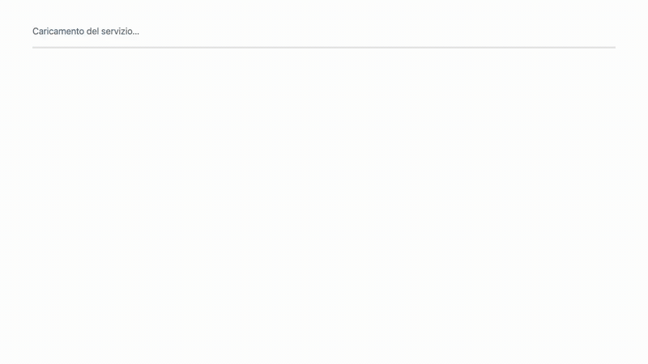
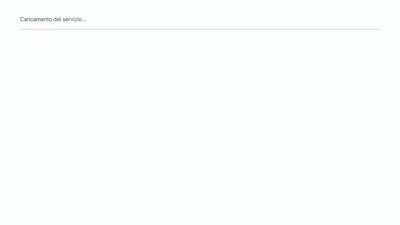

# QuandoPassa

**Il bus urbano sulla mappa, senza mettere un GPS sui bus.** QuandoPassa legge l'orario ufficiale in formato GTFS
e mostra dove si trova ogni bus *secondo l'orario*, qual è la fermata più vicina, tra quanti minuti arriva il
prossimo bus e se fai in tempo a prenderlo. Con un assistente IA in italiano e un server MCP per altri agenti.
Open source (EUPL-1.2), riusabile da qualsiasi Comune con un feed GTFS.
Pilota proposto: servizio urbano di **Gioia del Colle**, Circolari A e B.

📖 **Documentazione completa:** https://gzileni.github.io/quandopassa/



> Proposta indipendente, non un servizio ufficiale del Comune. Le posizioni dei bus sono **stime dall'orario
> programmato** (non c'è un GPS a bordo) e l'app lo dichiara sempre. La demo usa un orologio fisso su un mercoledì
> mattina.

Il README è diviso in tre parti: **[Cittadini](#1-per-i-cittadini)** ·
**[Comune](#2-per-il-comune)** · **[Sviluppatori e ufficio IT](#3-per-sviluppatori-e-ufficio-it)**.

---

## 1. Per i cittadini

Una pagina web, dal telefono o dal computer: niente app da installare, niente registrazione.

| Cosa fai | Cosa ottieni |
|---|---|
| Apri la mappa | I bus in servizio che si muovono lungo le strade, con linea e direzione |
| Tocchi **Usa la mia posizione** | Le fermate più vicine, i minuti a piedi e per ogni bus "fai in tempo", "affrettati" o "non fai in tempo" |
| Apri una fermata | Il **bus in arrivo**: tra quanti minuti, a quante fermate e quanti metri, dov'è adesso |
| Apri **Come arrivo** e scegli partenza e arrivo | Come su un navigatore: quanto camminare, quale bus, **dove cambiare**, a che ora arrivi; il viaggio sulla mappa |
| Chiedi all'**assistente** *"come arrivo al cimitero?"* | La stessa risposta, in italiano |
| Tocchi **Acquista il biglietto** | Si apre la biglietteria online dell'azienda di trasporto: QuandoPassa non vende biglietti |
| Ci sono lavori, scioperi o deviazioni | Un **avviso** in alto; la fermata sospesa è segnata in rosso e gli itinerari la evitano |

**Onestà sui dati.** Senza GPS a bordo il ritardo non è misurabile: l'app scrive "Ritardo: non rilevabile"
invece di un "in orario" che non può verificare. La posizione resta sul telefono e non viene salvata.

**Come arrivo** — da una fermata, un indirizzo, un luogo o un punto sulla mappa:



→ [Guida per i cittadini](https://gzileni.github.io/quandopassa/cittadini/) ·
[video verticale](docs/demo/quandopassa-demo-verticale.mp4) ·
[video "come arrivo" verticale](docs/demo/quandopassa-come-arrivo-verticale.mp4)

---

## 2. Per il Comune

| Beneficio | Come |
|---|---|
| **Nessun hardware** | Niente apparati AVM/GPS, SIM o centrale: basta l'orario in GTFS. |
| **Nessun dato personale** | Nessun account per i cittadini e nessun loro dato salvato; l'assistente non riceve dati personali. |
| **Backoffice per l'ufficio trasporti** | Da `/admin` si cambiano fermate, linee, orari e calendari, si pubblicano **avvisi** (fermate sospese, deviazioni, giorni di servizio sospeso) e si personalizzano logo e intestazione. La mappa si aggiorna subito e il GTFS si scarica sempre aggiornato. |
| **Design della PA** | Interfaccia [Bootstrap Italia](https://italia.github.io/bootstrap-italia/) responsive e accessibile, font e icone in locale, nessuna CDN di terzi. |
| **Pensiline** | Le fermate sono le 20 aree della proposta di localizzazione delle pensiline, geocodificate su OpenStreetMap. |
| **IA sotto controllo** | Uso informativo a basso rischio (AI Act art. 50), motore predefinito offline, orari mai inventati dal modello. |
| **Dati aperti e integrazione** | Feed GTFS standard, API JSON aperte e server MCP. |
| **Biglietti fuori dal sito** | Nessuna vendita né pagamento: un pulsante porta alla biglietteria online del gestore (`LINK_BIGLIETTI`). |
| **Riuso** | Un altro Comune cambia il feed GTFS e il file `.env` (o lo fa dal backoffice); codice EUPL-1.2 con `publiccode.yml`. |

Evoluzione naturale: con un feed **GTFS-Realtime** dell'azienda di trasporto, posizioni e ritardi veri al posto
delle stime.

**Pronto per il riuso nella PA.** Licenza EUPL-1.2, `publiccode.yml` verificato dai test, `CONTRIBUTING.md`,
`SECURITY.md`, `CHANGELOG.md`; dipendenze senza vulnerabilità note (`pip-audit`, `npm audit`); audit di
accessibilità axe-core senza violazioni WCAG 2.1 AA (`make accessibilita`); posizione e ricerche mai salvate né
scritte nei log.

→ [Benefici per il Comune](https://gzileni.github.io/quandopassa/comune/) ·
[Backoffice](https://gzileni.github.io/quandopassa/backoffice/) ·
[Il feed GTFS e le fermate](https://gzileni.github.io/quandopassa/gtfs/) ·
[Conformità normativa](https://gzileni.github.io/quandopassa/conformita/) ·
[Riuso e Catalogo Developers Italia](https://gzileni.github.io/quandopassa/riuso/)

---

## 3. Per sviluppatori e ufficio IT

```bash
make up          # crea .env da .env.example, costruisce e avvia
# app       http://localhost:8000      (API: /api/docs)
# MCP       http://localhost:8090/mcp
make demo        # istanza demo su :8001 con orologio fisso (mercoledì 09:00)
make test        # suite pytest nel container
make backoffice  # attiva il backoffice /admin (chiede utente e password, avvia Postgres)
```

### Installare su una macchina virtuale Linux (senza Docker)

Se nell'ente Docker non si può usare, basta una macchina virtuale Linux e **un solo comando**: lo script
installa tutto, configura il server web e alla fine controlla che funzioni.

**1. Prepara la macchina virtuale.** Requisiti minimi:

| | Solo app per i cittadini | Con il backoffice | Con l'IA locale |
|---|---|---|---|
| Processore | 1 vCPU | 2 vCPU | 4 vCPU |
| Memoria | 2 GB | 2 GB | 8 GB |
| Disco | 10 GB | 20 GB | 30 GB |

- Linux a 64 bit: **Ubuntu 22.04 o 24.04**, **Debian 12 o 13**, **Rocky / AlmaLinux / RHEL 8 o 9**, Fedora.
- Un utente che può usare `sudo`.
- Internet durante l'installazione (per scaricare i programmi necessari).
- Porte **80** e **443** aperte verso gli utenti; per l'HTTPS un nome (es. `bus.comune.it`) che punta alla
  macchina.

**2. Scarica QuandoPassa e installa:**

```bash
git clone https://github.com/gzileni/quandopassa.git
cd quandopassa
sudo ./deploy/install.sh --backoffice
```

Alla fine lo script mostra l'indirizzo dell'app (`http://indirizzo-della-macchina`) e del backoffice
(`/admin/`). La password del backoffice la chiede durante l'installazione; se lo script gira senza tastiera la
genera e la mostra **una sola volta**.

**3. Con un nome e l'HTTPS** (consigliato in esercizio):

```bash
sudo ./deploy/install.sh --backoffice --dominio bus.comune.it --email it@comune.it
```

**Dopo l'installazione:**

| Per… | Comando |
|---|---|
| vedere se tutto funziona | `sudo quandopassa stato` |
| leggere i log | `sudo quandopassa log app` |
| cambiare la configurazione | `sudo quandopassa config` (oppure dal backoffice, pagina Impostazioni) |
| cambiare la password del backoffice | `sudo quandopassa password` |
| fare un backup subito | `sudo quandopassa backup` (ce n'è già uno ogni notte) |
| aggiornare a una nuova versione | `git pull`, poi di nuovo `sudo ./deploy/install.sh` |

Senza `--backoffice` si installa solo l'app per i cittadini, senza database. Tutte le opzioni:
`sudo ./deploy/install.sh --aiuto` →
[Installazione su VM](https://gzileni.github.io/quandopassa/installazione/#su-una-macchina-virtuale-linux-senza-docker)

### Come è fatto

Tre container, più **Postgres** solo se si attiva il backoffice (`make backoffice`):

- **app** (`api/` + `web/`): FastAPI con il motore GTFS (posizioni stimate, partenze, fermate vicine, ricerca),
  il calcolo degli itinerari con cambi (`itinerari.py`), la ricerca dei luoghi su OpenStreetMap e l'assistente; interfaccia React con Vite, Bootstrap Italia e Leaflet su OpenStreetMap.
  L'interfaccia scarica una volta l'orario del giorno e anima i bus da sola, allineata all'ora del server.
- **inference** (`inference/`): server OpenAI-compatibile, backend `rules` (offline, predefinito) o `openai`
  (Ollama del profilo `llm`, vLLM, Azure OpenAI…). L'IA capisce la domanda, l'app calcola la risposta, l'LLM può
  solo riformularla: una riformulazione con numeri diversi viene scartata.
- **mcp** (`mcp_server/`): server MCP in sola lettura con `cerca_fermata`, `fermate_vicine`,
  `prossime_partenze`, `bus_in_servizio`, `come_arrivare`, `orari_linea`, `chiedi_assistente`.
- **backoffice** (`/admin`, facoltativo): fermate, linee, orari, calendari, avvisi e intestazione in Postgres.
  A ogni salvataggio il feed GTFS viene rigenerato, verificato e ricaricato senza riavvio; l'app pubblica legge
  solo i file, quindi funziona anche se il database si ferma.

Senza backoffice il feed è nella cartella `GTFS_DIR` (predefinita `data/`): `fermate.csv` e `percorsi.json` sono le sorgenti,
`make gtfs` rigenera i file GTFS e `make geocode` cerca le fermate su OpenStreetMap e i tracciati stradali con
OSRM (lo fa anche il workflow **geocoding** a ogni modifica).

→ [Installazione](https://gzileni.github.io/quandopassa/installazione/) ·
[Configurazione](https://gzileni.github.io/quandopassa/configurazione/) ·
[Architettura e API](https://gzileni.github.io/quandopassa/architettura/) ·
[Intelligenza artificiale](https://gzileni.github.io/quandopassa/intelligenza-artificiale/) ·
[Server MCP](https://gzileni.github.io/quandopassa/mcp/) ·
[Installazione conforme PA](https://gzileni.github.io/quandopassa/normativa-it/) ·
[Video e demo](https://gzileni.github.io/quandopassa/video/)

---

## Licenza

EUPL-1.2 · Agent Engineering Studio e contributori.
