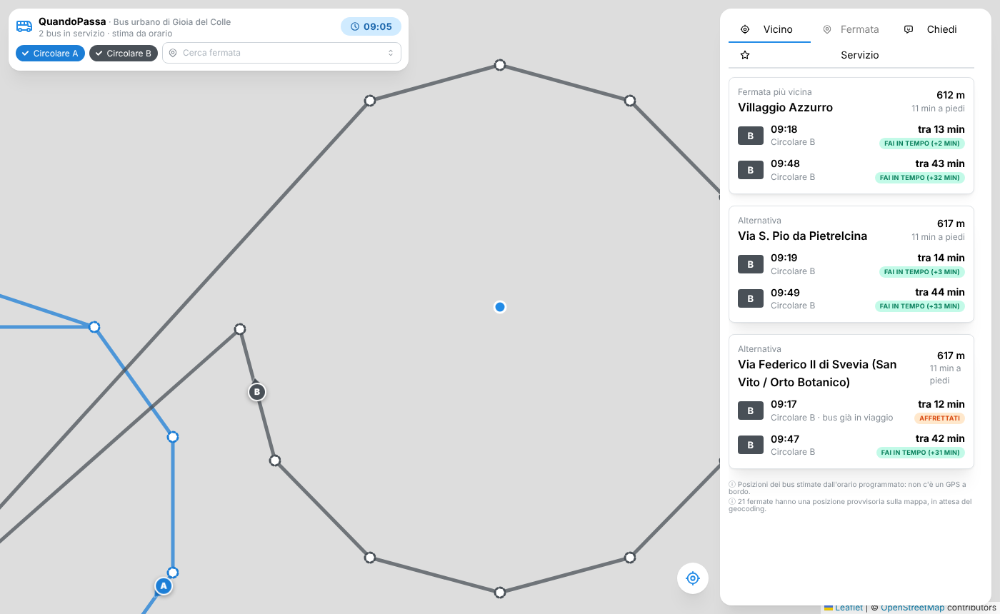

# QuandoPassa

**Il bus urbano sulla mappa, come su Google Maps, senza mettere un GPS sui bus.**
QuandoPassa legge l'orario ufficiale in formato GTFS, lo confronta con l'ora attuale e con la posizione del
telefono e mostra dove si trova ogni bus *secondo l'orario*, qual è la fermata più vicina e se fai in tempo
a prenderlo. Include un assistente IA, le recensioni dei cittadini su fermate e servizio e un server MCP per
collegare agenti esterni. Open source (EUPL-1.2), riusabile da qualsiasi Comune con un feed GTFS.

Pilota: servizio urbano di **Gioia del Colle**, Circolari A e B, con le 20 aree della proposta preliminare di
localizzazione delle pensiline.

> Proposta indipendente, non un servizio ufficiale del Comune. Le posizioni dei bus sono stime dall'orario
> programmato: l'app lo dichiara sempre.



## Cosa fa

**Mappa in tempo reale senza IoT.** Ogni secondo il browser calcola la posizione di ogni bus interpolando tra gli
orari di passaggio delle fermate, lungo il tracciato stradale della linea (`shapes.txt`) o, se manca, lungo la
spezzata tra le fermate. I bus si muovono con la loro freccia di direzione, il colore della linea e la prossima
fermata con l'orario previsto.

**Vicino a te.** Con la posizione del telefono trova le fermate più vicine, stima i minuti a piedi e per ogni
passaggio dice "fai in tempo (+4 min)", "affrettati" o "non fai in tempo". La posizione resta sul dispositivo.

**Fermate e recensioni stile Google Maps.** Stelle da 1 a 5, distribuzione dei voti, etichette (pensilina,
illuminata, puntuale, affollata…), commenti e una sintesi automatica. Si valutano le fermate, le linee e il
servizio. Nessun account, nessun dato personale: email e telefoni scritti nel testo vengono rimossi e dell'IP
resta solo un'impronta giornaliera per il limite anti-spam. L'ufficio può nascondere le recensioni fuori tema.

**Assistente IA.** "Quando passa il prossimo bus da Piazza Plebiscito?", "Come arrivo al cimitero?",
"Dov'è adesso la linea B?". Come in [Spazio Comune](https://github.com/agent-engineering-studio/spazio-comune),
il server di inferenza *capisce* la frase, l'app *calcola* la risposta dall'orario e un LLM, se configurato,
può solo *riformularla*: una riformulazione che cambia orari o minuti viene scartata. Il backend predefinito è
a regole, offline, e nessun dato esce dal server.

**Server MCP.** Gli stessi dati come strumenti per Claude, Copilot o qualsiasi orchestratore agentico:
`cerca_fermata`, `fermate_vicine`, `prossime_partenze`, `bus_in_servizio`, `come_arrivare`, `orari_linea`,
`chiedi_assistente`, `recensioni`, `riepilogo_recensioni`. Facoltativi: `lascia_recensione` (con consenso della
persona) e gli strumenti di moderazione per l'ufficio.

**Simulazione dell'orario.** Fuori servizio (il servizio pilota è solo al mattino, lun-sab) l'orologio in alto
permette di vedere la rete a qualsiasi ora; `DEMO_ORA` nel `.env` fa partire tutta l'app da un istante fisso.

## Avvio rapido

```bash
cp .env.example .env
docker compose up --build
# app       http://localhost:8000      (API: /api/docs)
# MCP       http://localhost:8090/mcp
```

Senza Docker, per sviluppo:

```bash
pip install -r api/requirements.txt -r inference/requirements.txt
(cd inference && uvicorn server:app --port 8080) &
(cd api && INFERENCE_URL=http://127.0.0.1:8080 uvicorn --factory quandopassa.main:create_app --reload) &
(cd web && npm install && npm run dev)        # http://localhost:5173
```

Senza `DATABASE_URL` le recensioni stanno in memoria. Test: `pytest` (con `TEST_DATABASE_URL` anche su PostgreSQL)
oppure `docker compose --profile test run --rm test`.

## Il feed GTFS

La cartella del feed è nel `.env`:

```dotenv
GTFS_DIR=./data
```

`data` contiene il feed generato dalla proposta delle 20 aree (Circolari A e B, documento del
9/11/2026). Le sorgenti modificabili a mano sono due:

- `fermate.csv`: le fermate (area, nome, linee, tipologia pensilina/fermata leggera, nota, strategia di
  ricerca, coordinate e loro fonte);
- `percorsi.json`: agenzia, calendari, sequenza delle fermate per linea con i minuti di percorrenza e le
  partenze dal capolinea. Tempi e partenze vengono dal template GTFS Sabato Viaggi, tenendo solo le fermate
  della proposta.

L'area 20 (Via Federico II di Svevia) ha due punti di fermata, lato zona produttiva e lato Villaggio Azzurro,
perché la Circolare B la percorre prima e dopo Seven. La Circolare A ordinaria non circola il martedì (giorno di
mercato, con un percorso diverso che la proposta non copre).

```bash
python scripts/build_gtfs.py data          # rigenera i file .txt
python scripts/geocode_stops.py data --forme  # geocoding + tracciati stradali
```

**Geocoding.** Per ogni fermata `geocode_stops.py` prova in ordine le strategie della colonna `ricerca`:
`incrocio:Via A|Via B` cerca su OpenStreetMap (Overpass) il nodo in comune tra due strade, il testo libero usa
Nominatim limitato al territorio comunale. Poi chiede a OSRM il tracciato stradale di ogni linea attraverso le sue
fermate e lo scrive in `forme.json`, da cui nasce `shapes.txt`. Il workflow GitHub **geocoding** lo fa da solo a
ogni modifica di `fermate.csv` o `percorsi.json` e fa il commit dei file aggiornati.

Le posizioni da OpenStreetMap restano **indicative**, come la proposta stessa: i corridoi con più strade vanno
fissati con il sopralluogo. Dopo il rilievo basta scrivere `lat`, `lon` e `fonte=manuale` in `fermate.csv`: il
geocoding non tocca più quella riga. Finché una fermata non ha coordinate, l'app la mostra in posizione
provvisoria con il bordo tratteggiato e un avviso.

Un altro Comune può usare qualsiasi feed GTFS esistente: basta copiarlo in una cartella (es. `data/altro`) e cambiare
`GTFS_DIR` (le colonne extra di questo repository sono facoltative).

## Architettura

Quattro servizi in `docker-compose.yml`:

- **app** (`api/` + `web/`): FastAPI con il motore GTFS (`gtfs.py`: calendario, posizioni stimate, partenze,
  fermate vicine, ricerca, percorsi diretti a piedi + bus), le recensioni (`feedback.py`, PostgreSQL) e
  l'assistente (`assistente.py`); serve l'interfaccia React costruita con Vite, Mantine e Leaflet su
  OpenStreetMap. L'interfaccia scarica una volta l'orario del giorno e anima i bus da sola.
- **db**: PostgreSQL 17, solo rete interna.
- **inference** (`inference/`): server OpenAI-compatibile con backend `rules` (offline) o `openai`
  (Ollama del profilo `llm`, vLLM, Azure OpenAI…). Endpoint `/v1/tasks/intent`, `/answer`, `/faq`, `/summary`.
- **mcp** (`mcp_server/`): server MCP (stdio o HTTP streamable) che usa solo le API HTTP dell'app.

Per collegare l'MCP a Claude Desktop o Claude Code in stdio:

```json
{ "mcpServers": { "quandopassa": { "command": "python", "args": ["mcp_server/server.py"],
  "env": { "QUANDOPASSA_URL": "http://localhost:8000" } } } }
```

## IA e conformità

L'IA ha un ruolo informativo a basso rischio ed è dichiarata nell'interfaccia (AI Act, art. 50). Gli orari li
calcola sempre il codice dall'orario ufficiale. I dati personali vengono rimossi prima di ogni invio a un LLM, e
ogni risposta riporta se è stata generata con IA e con quale backend. Il backend predefinito non usa modelli. Prima
di passare a `openai` in esercizio serve la valutazione prevista dalle Linee guida AgID, con un LLM interno o un
fornitore qualificato ACN.

## Licenza

EUPL-1.2 · Agent Engineering Studio e contributori.
