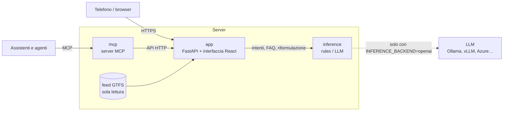

# Architettura e API

Tre servizi in `docker-compose.yml`. L'unico dato conservato è l'archivio dei **biglietti** (SQLite sul volume
`biglietti`, anonimo); tutto il resto si ricalcola dall'orario.

app (`api/` + `web/`)
:   FastAPI con il motore GTFS (`gtfs.py`: calendario, posizioni stimate, partenze, fermate vicine, ricerca,
    percorsi diretti a piedi + bus) e l'assistente (`assistente.py`). Serve l'interfaccia React, costruita con
    Vite, Bootstrap Italia e Leaflet su OpenStreetMap.

inference (`inference/`)
:   server OpenAI-compatibile con backend `rules` (offline) o `openai`. Endpoint `/v1/tasks/intent`,
    `/v1/tasks/answer`, `/v1/tasks/faq` e `/v1/chat/completions`.

mcp (`mcp_server/`)
:   server MCP (stdio o HTTP streamable) che usa solo le API HTTP dell'app.

## Come si stima la posizione dei bus

L'interfaccia scarica **una volta** l'orario del giorno (`/api/v1/orario`: corse, orari di passaggio e
tracciati) e ogni secondo calcola da sola la posizione di ogni bus:

1. trova la corsa in svolgimento e il tratto tra le due fermate in cui si trova il bus, in base all'ora;
2. interpola la distanza percorsa in proporzione al tempo trascorso tra le due fermate;
3. colloca il bus a quella distanza lungo il tracciato stradale (`shapes.txt`) e ne ricava la direzione.

## Come arrivo: il calcolo degli itinerari

`itinerari.py` cerca, per ogni fermata entro 1 km dalla partenza, i bus dei prossimi giorni: scende alla fermata da
cui si arriva prima a destinazione (contando il tratto finale a piedi) oppure cambia una volta, con almeno un
minuto e al massimo un'ora di attesa. Le soluzioni sono ordinate per orario di arrivo, poi per numero di cambi e
metri a piedi; quelle che escono prima e arrivano dopo un'altra vengono scartate. "Solo a piedi" compare per
prima quando si arriva prima che in bus, e sotto i 600 m è l'unica proposta. I tratti in bus seguono il
tracciato stradale; quelli a piedi sono stimati in linea d'aria corretta per la tortuosità delle strade.

Il **bus in arrivo** a una fermata è il primo bus in viaggio che deve ancora passarci: i minuti vengono
dall'orario di arrivo previsto, fermate e metri dal tracciato. L'orologio dell'interfaccia è allineato a quello
del server (`/api/v1/ora`), così non dipende dall'ora del telefono.

## API aperte

JSON su `/api/v1`, documentate su `/api/docs` (OpenAPI). Gli orari sono in fuso Europe/Rome; il parametro
facoltativo `ora` (ISO 8601) calcola la risposta per un altro istante.

| Metodo | Percorso | Risposta |
|---|---|---|
| GET | `/health` | stato di app, feed e IA |
| GET | `/info` | servizio, linee, versione del feed, prossima corsa, avvisi |
| GET | `/ora` | orologio del servizio |
| GET | `/fermate` | tutte le fermate con le linee che le servono |
| GET | `/fermate/vicine?lat&lon&n` | fermate più vicine con distanza, minuti a piedi e prossimi passaggi |
| GET | `/fermate/cerca?q` | ricerca per nome |
| GET | `/fermate/{id}` | dettaglio e prossime partenze |
| GET | `/fermate/{id}/partenze?n&ora` | prossimi passaggi |
| GET | `/linee` | linee con tracciati e fermate |
| GET | `/orario?giorno` | corse e tracciati del giorno |
| GET | `/veicoli?ora&linea` | bus in servizio con posizione stimata (`tempo_reale: false`) |
| GET | `/itinerari?da_lat&da_lon&a_lat&a_lon` | come arrivo porta a porta: a piedi, bus, al massimo un cambio, solo a piedi se conviene |
| GET | `/luoghi?q` | fermate, indirizzi e luoghi per scegliere partenza e arrivo |
| GET | `/percorso?lat&lon&a` | bus diretto verso una fermata (compatibilità) |
| GET | `/assistente?testo&lat&lon` | assistente IA |
| GET | `/biglietti` | tariffe dal `.env` e modalità di pagamento |
| POST | `/biglietti/acquisti` | nuovo acquisto: chiave del dispositivo e riferimento di pagamento |
| POST | `/biglietti/acquisti/{id}/conferma` | emette il titolo a pagamento riuscito (idempotente) |
| POST | `/biglietti/portafoglio` · `/biglietti/titoli/{id}/attiva` | titoli del dispositivo; attivazione con codice e QR firmato |
| POST | `/biglietti/verifica` | esito per il controllore (HTTP Basic) |
