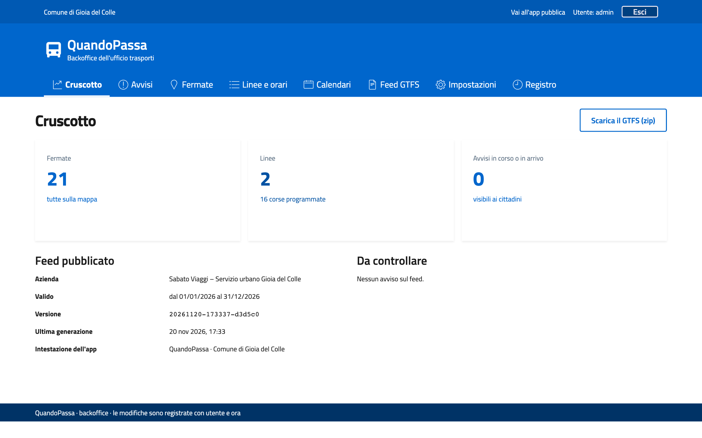
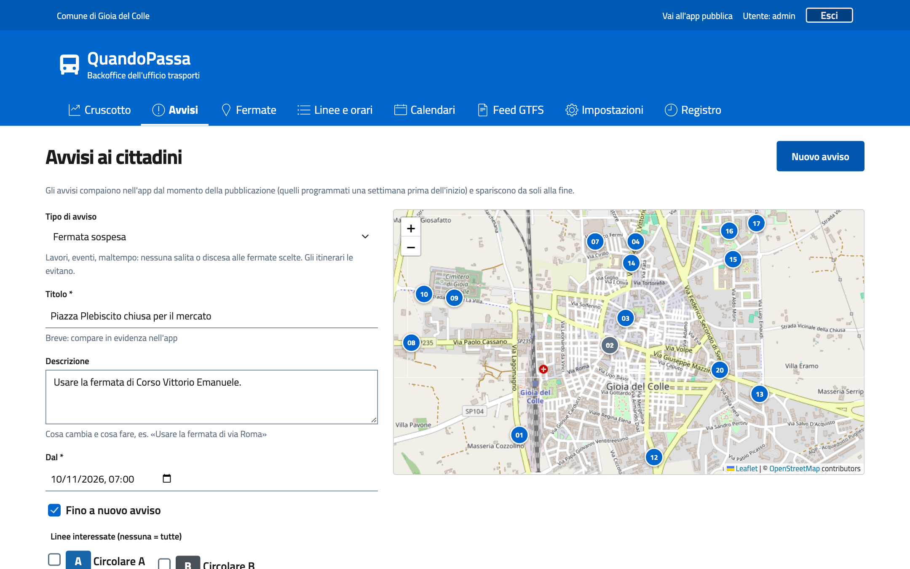
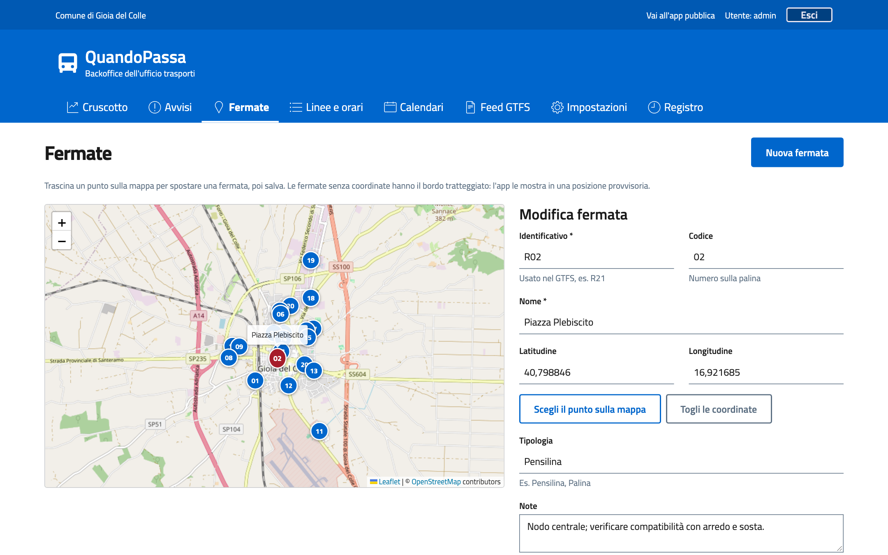
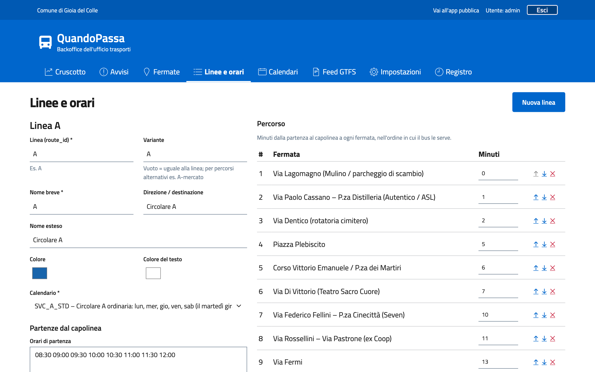
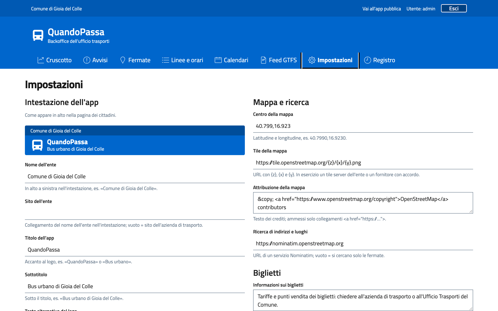
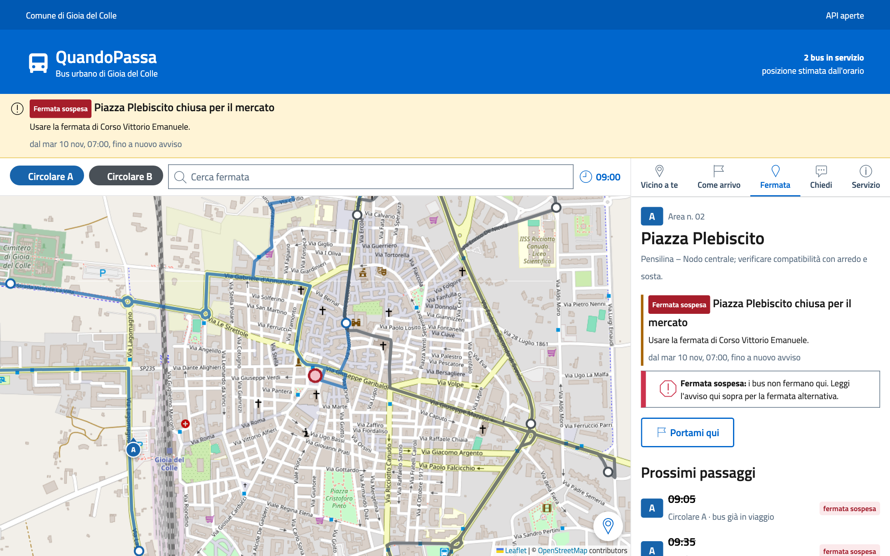
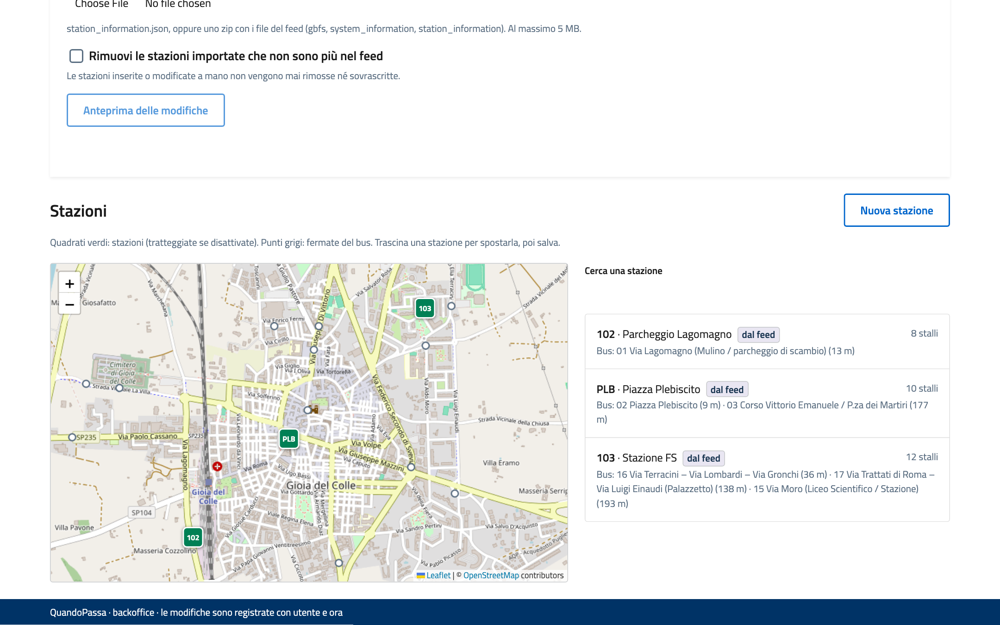
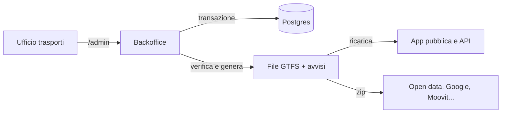

# Backoffice

Il backoffice è la parte riservata all'**ufficio trasporti**, all'indirizzo `/admin/` dell'app. Si entra con
utente e password (scritti nel file `.env`); ogni modifica si vede **subito** sulla mappa dei cittadini.

<video class="video-demo" controls muted playsinline preload="metadata" poster="../screenshot/09_backoffice.png">
  <source src="../demo/quandopassa-backoffice.mp4" type="video/mp4">
</video>

| Sezione | Cosa si fa |
|---|---|
| **Cruscotto** | Stato del feed pubblicato, avvisi in corso, problemi da sistemare (fermate senza posizione, feed in scadenza…) |
| **Avvisi** | Avvisi ai cittadini: **fermata sospesa**, **deviazione temporanea**, **servizio sospeso** (sciopero, festività), **informazione** |
| **Fermate** | Elenco e mappa; si sposta una fermata trascinando il punto; nuove fermate con un clic sulla mappa |
| **Linee e orari** | Percorso con i minuti dalla partenza, partenze dal capolinea (anche "dalle 8 alle 12 ogni 30 minuti"), colori, tracciato su strada |
| **Calendari** | Giorni di servizio ed eccezioni |
| **Bike sharing** | Stazioni di bici condivise: import dal feed **GBFS** del gestore con anteprima, stazioni sulla mappa con le fermate del bus vicine, disponibilità in tempo reale |
| **Feed GTFS** | Azienda di trasporto, periodo di validità, **download del GTFS** (zip) |
| **Impostazioni** | **Intestazione dell'app** (logo, nome dell'ente e collegamento al suo sito, titolo, sottotitolo), mappa, ricerca dei luoghi, biglietti |
| **Registro** | Chi ha modificato cosa e quando |

<div class="grid screens" markdown>















</div>

## Come funziona



- I dati modificabili stanno in **Postgres**. A ogni salvataggio il server **rigenera il feed GTFS**, lo
  **verifica** e, solo se è corretto, lo sostituisce a quello pubblicato e lo ricarica: nessun riavvio.
- Se la modifica renderebbe il feed non valido (una linea con una fermata che non esiste, una data di fine prima
  di quella di inizio…) **non viene salvata** e il backoffice spiega perché.
- L'app pubblica legge **solo i file**: se il database si ferma, mappa e orari continuano a funzionare.
- Il GTFS si scarica in qualsiasi momento ed è sempre allineato al database (pagina **Feed GTFS**).
- Le pagine aperte dai cittadini si accorgono del nuovo feed entro due minuti e si aggiornano da sole.

### Gli avvisi

| Tipo | Effetto nell'app | Effetto nel GTFS |
|---|---|---|
| Fermata sospesa | Barra in alto, fermata in rosso sulla mappa, partenze segnate "fermata sospesa", gli itinerari la evitano | — (non esiste nel GTFS statico) |
| Deviazione temporanea | Barra in alto, percorso provvisorio tratteggiato sulla mappa, fermate saltate come sopra | — |
| Servizio sospeso | Barra in alto; nei giorni indicati i bus delle linee scelte non compaiono | Eccezioni in `calendar_dates.txt` |
| Informazione | Barra in alto | — |

Gli avvisi compaiono una settimana prima dell'inizio (come "programmati") e spariscono da soli alla fine. Sono
anche nell'API pubblica `GET /api/v1/alerts`, utile per siti e servizi dell'ente.

### Il bike sharing

La pagina **Bike sharing** affianca alle fermate del bus le stazioni di bici condivise (per esempio Glor di
VAIMOO, dove il Comune ha un accordo con il gestore).

- **Sistema**: nome mostrato ai cittadini, gestore, link all'app per il noleggio (QuandoPassa non gestisce
  noleggi né pagamenti), indirizzi del feed e licenza dei dati.
- **Import da GBFS** ([General Bikeshare Feed Specification](https://gbfs.org), v2.x e v3.0): dall'indirizzo
  `gbfs.json` del gestore, da `station_information.json` o da un file caricato (JSON o zip con i file del feed).
  Prima si vede l'**anteprima** (stazioni nuove, aggiornate, invariate, non più nel feed), poi si conferma.
  Le stazioni inserite o modificate a mano non vengono mai sovrascritte né rimosse dagli import successivi.
- **Stazioni** sulla mappa insieme alle fermate del bus: si spostano trascinandole, si aggiungono, si
  disattivano. Per ogni stazione il backoffice indica le fermate del bus entro 300 m.
- **Disponibilità in tempo reale**: se il gestore pubblica `station_status`, il server la legge con una cache
  che rispetta il `ttl` del feed (da 30 a 300 secondi). La posizione di chi usa l'app non arriva mai al gestore.
  Se il gestore non risponde le stazioni restano visibili senza i numeri. «Verifica disponibilità» prova il
  collegamento.

Nell'app dei cittadini le stazioni compaiono sulla mappa come quadrati verdi con le bici libere, con il
pulsante **Bici** per mostrarle o nasconderle e le stazioni più vicine nella scheda della fermata (vedi
[Usare QuandoPassa](cittadini.md#bici-condivise)).

Le stazioni pubblicate sono in `bike_sharing.json` accanto al feed GTFS (non fanno parte del GTFS) e nelle API
pubbliche `GET /api/v1/bikes/stations` e `GET /api/v1/bikes/nearby?lat&lon`; la scheda di una fermata
(`/api/v1/fermate/{id}`) elenca le stazioni vicine in `bikes_nearby`.

## Accesso

Il backoffice è **sempre attivo**. Utente e password stanno nel file di configurazione `.env`:

```ini
ADMIN_USER=admin
ADMIN_PASSWORD=una-password-lunga-almeno-12-caratteri
```

=== "Docker"

    `make up` (o `make env`) completa da solo le righe vuote: chiede la password o, se non c'è un terminale,
    la genera, la scrive nel `.env` e la mostra. Avvia sempre anche Postgres. Poi apri
    `http://localhost:8000/admin/`.

    Cambiare la password: `make password`, oppure modificare `ADMIN_PASSWORD` nel `.env` e lanciare `make up`.

=== "Macchina virtuale"

    `sudo ./deploy/install.sh` installa anche Postgres e il backoffice; alla prima installazione chiede la
    password (o la genera e la mostra) e la scrive in `/etc/quandopassa/quandopassa.env`. Vedi
    [Installazione](installazione.md#su-una-macchina-virtuale-linux-senza-docker).

    Cambiare la password: `sudo quandopassa password`, oppure modificare `ADMIN_PASSWORD` con
    `sudo quandopassa config`.

La password deve avere almeno 12 caratteri, senza spazi né `$ " ' # \ `` ` ``. Chi non vuole tenerla in chiaro nel
file può scrivere al suo posto l'hash in `ADMIN_PASSWORD_HASH` (`python -m quandopassa.password`), che ha la
precedenza. Cambiando la password le sessioni aperte si chiudono.

Al primo avvio il database viene popolato con il feed in uso (`GTFS_DIR`): da quel momento i dati si modificano
dal backoffice.

## Sicurezza

- Un solo utente, definito nel `.env` (`ADMIN_USER`, `ADMIN_PASSWORD`). Il file va protetto: è leggibile solo
  dall'amministratore e dal servizio (permessi 600 in Docker, 640 sulla macchina virtuale), e lo stesso vale per
  le sue copie e i backup. In alternativa si può tenere solo l'hash scrypt (`ADMIN_PASSWORD_HASH`).
- Sessione in un cookie tecnico `HttpOnly`, `SameSite=Strict`, `Secure` in HTTPS, valida 8 ore; token CSRF su
  ogni modifica; dopo 5 tentativi sbagliati l'accesso si blocca per 15 minuti (e nginx limita i tentativi).
- Sulla macchina virtuale `--admin-da 10.0.0.0/8` apre `/admin` solo dalla rete dell'ente.
- Credenziali, cartelle, database e intelligenza artificiale **non** si cambiano dal backoffice: restano nel
  `.env`, gestito dal sistemista.
- Il logo accetta solo PNG, JPEG, WebP e SVG senza script, fino a 512 kB.
- Ogni modifica è nel **registro** con utente e ora.

In esercizio il backoffice va pubblicato **solo in HTTPS**.
