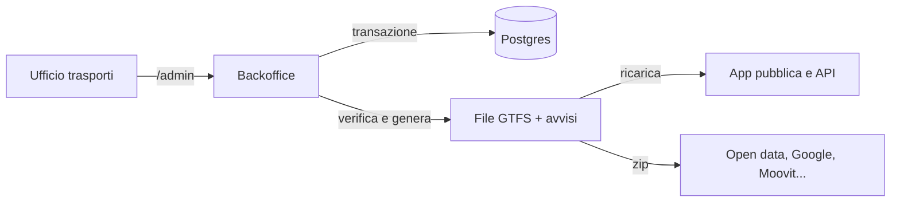

# Backoffice

Il backoffice è la parte riservata all'**ufficio trasporti**, all'indirizzo `/admin/` dell'app. Si entra con
utente e password; ogni modifica si vede **subito** sulla mappa dei cittadini.

| Sezione | Cosa si fa |
|---|---|
| **Cruscotto** | Stato del feed pubblicato, avvisi in corso, problemi da sistemare (fermate senza posizione, feed in scadenza…) |
| **Avvisi** | Avvisi ai cittadini: **fermata sospesa**, **deviazione temporanea**, **servizio sospeso** (sciopero, festività), **informazione** |
| **Fermate** | Elenco e mappa; si sposta una fermata trascinando il punto; nuove fermate con un clic sulla mappa |
| **Linee e orari** | Percorso con i minuti dalla partenza, partenze dal capolinea (anche "dalle 8 alle 12 ogni 30 minuti"), colori, tracciato su strada |
| **Calendari** | Giorni di servizio ed eccezioni |
| **Feed GTFS** | Azienda di trasporto, periodo di validità, **download del GTFS** (zip) |
| **Impostazioni** | **Intestazione dell'app** (logo, nome dell'ente e collegamento al suo sito, titolo, sottotitolo), mappa, ricerca dei luoghi, biglietti |
| **Registro** | Chi ha modificato cosa e quando |

## Come funziona



- I dati modificabili stanno in **Postgres**. A ogni salvataggio il server **rigenera il feed GTFS**, lo
  **verifica** e, solo se è corretto, lo sostituisce a quello pubblicato e lo ricarica: nessun riavvio.
- Se la modifica renderebbe il feed non valido (una linea con una fermata che non esiste, una data di fine prima
  di quella di inizio…) **non viene salvata** e il backoffice spiega perché.
- L'app pubblica legge **solo i file**: se il database si ferma, mappa e orari continuano a funzionare.
- Il GTFS si scarica in qualsiasi momento ed è sempre allineato al database (pagina **Feed GTFS**).
- Le pagine aperte dai cittadini si accorgono del nuovo feed entro due minuti e si aggiornano da sole.

### Gli avvisi

| Tipo | Effetto nell'app | Effetto nel GTFS |
|---|---|---|
| Fermata sospesa | Barra in alto, fermata in rosso sulla mappa, partenze segnate "fermata sospesa", gli itinerari la evitano | — (non esiste nel GTFS statico) |
| Deviazione temporanea | Barra in alto, percorso provvisorio tratteggiato sulla mappa, fermate saltate come sopra | — |
| Servizio sospeso | Barra in alto; nei giorni indicati i bus delle linee scelte non compaiono | Eccezioni in `calendar_dates.txt` |
| Informazione | Barra in alto | — |

Gli avvisi compaiono una settimana prima dell'inizio (come "programmati") e spariscono da soli alla fine. Sono
anche nell'API pubblica `GET /api/v1/alerts`, utile per siti e servizi dell'ente.

## Attivarlo

=== "Docker"

    ```bash
    make backoffice        # chiede utente e password, prepara il database e riavvia
    ```

    Il comando compila la sezione **Backoffice** del `.env` e avvia anche Postgres (profilo `backoffice`).
    Poi apri `http://localhost:8000/admin/`.

=== "Macchina virtuale"

    ```bash
    sudo ./deploy/install.sh --backoffice
    ```

    Installa Postgres sulla stessa macchina, chiede la password (o la genera e la mostra una volta) e attiva il
    backup giornaliero. Vedi [Installazione](installazione.md#su-una-macchina-virtuale-linux-senza-docker).

Al primo avvio il database viene popolato con il feed in uso (`GTFS_DIR`): da quel momento i dati si modificano
dal backoffice.

**Cambiare la password**: `make password` (Docker, poi copiare la riga nel `.env` e `make up`) oppure
`sudo quandopassa password` (macchina virtuale).

## Sicurezza

- Un solo utente, definito nel `.env` (`ADMIN_USER`, `ADMIN_PASSWORD_HASH`): nel file c'è solo l'**hash** della
  password (scrypt), mai la password in chiaro.
- Sessione in un cookie tecnico `HttpOnly`, `SameSite=Strict`, `Secure` in HTTPS, valida 8 ore; token CSRF su
  ogni modifica; dopo 5 tentativi sbagliati l'accesso si blocca per 15 minuti (e nginx limita i tentativi).
- Sulla macchina virtuale `--admin-da 10.0.0.0/8` apre `/admin` solo dalla rete dell'ente.
- Credenziali, cartelle, database e intelligenza artificiale **non** si cambiano dal backoffice: restano nel
  `.env`, gestito dal sistemista.
- Il logo accetta solo PNG, JPEG, WebP e SVG senza script, fino a 512 kB.
- Ogni modifica è nel **registro** con utente e ora.

In esercizio il backoffice va pubblicato **solo in HTTPS**.
