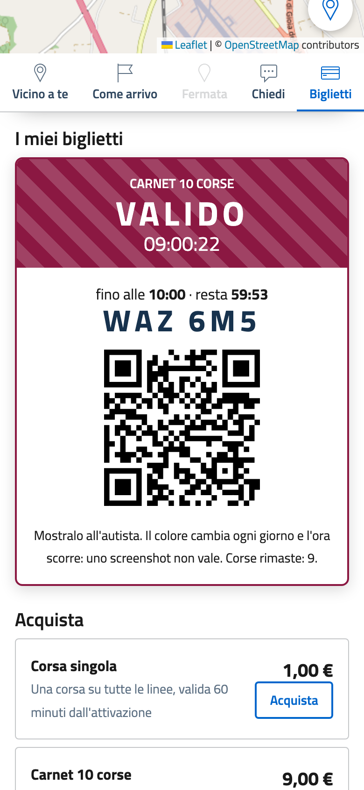

# Biglietti digitali (prototipo)

QuandoPassa include un **prototipo** di vendita dei titoli di viaggio: corsa singola, carnet e abbonamento, con
tariffe e regole nel file `.env`, acquisto senza registrazione, attivazione alla salita e verifica a bordo. Il
pagamento è **simulato**: serve a mostrare il servizio e a discuterlo con Comune e azienda di trasporto prima di
toccare pagamenti reali.

{ .telefono }

{ .telefono }

## Come funziona

1. **Acquisto.** Nella scheda **Biglietti** si sceglie il titolo; il telefono riceve una *chiave* segreta e il
   server ne conserva solo l'impronta (SHA-256). Nessun account, nessun nome, nessun codice fiscale.
2. **Pagamento.** L'app chiede il pagamento all'adattatore configurato (`PAGAMENTI`). Nel prototipo una pagina in
   stile pagoPA simula "Paga" e "Annulla": senza esito positivo il titolo non viene emesso.
3. **Attivazione alla salita.** Una corsa vale `VALIDITA_CORSA_MIN` minuti; il carnet ne scala una alla volta;
   l'abbonamento vale `GIORNI_ABBONAMENTO` giorni dall'acquisto. Riattivare un titolo già attivo non consuma un'altra
   corsa.
4. **A bordo.** Il biglietto attivo mostra il **colore del giorno**, fasce in movimento e l'**ora che scorre** con i
   secondi: l'autista lo riconosce a colpo d'occhio e uno screenshot non vale. Sotto ci sono un **codice di 6
   caratteri** (senza 0/O e 1/I, si detta senza errori) e un **QR firmato** (HMAC-SHA256).
5. **Verifica.** Il controllore apre `/verifica` dal telefono, entra con le sue credenziali (`VERIFICA_USER`,
   `VERIFICA_PASSWORD`) e legge il QR con la fotocamera (dove il browser lo consente) o scrive il codice: l'esito è
   **valido**, **scaduto** o **non valido**. Un QR alterato non supera la firma.

Il biglietto resta sul dispositivo: chi cambia telefono o cancella i dati del browser lo perde. In un servizio
reale si può offrire, facoltativamente, il recupero con email o SPID/CIE.

## Configurazione

| Variabile | Esempio | Significato |
|---|---|---|
| `BIGLIETTI_ATTIVI` | `true` | Vendita attiva (la scheda si chiama **Biglietti**); `false` = solo informazioni sul servizio |
| `PAGAMENTI` | `simulato` | `simulato`, `pagopa` (vende il Comune) o `gestore` (vende l'azienda): vedi sotto |
| `TARIFFA_CORSA` · `VALIDITA_CORSA_MIN` | `1.00` · `60` | Prezzo in euro e minuti di validità di una corsa |
| `TARIFFA_CARNET` · `CORSE_CARNET` | `9.00` · `10` | Prezzo e numero di corse del carnet |
| `TARIFFA_ABBONAMENTO` · `GIORNI_ABBONAMENTO` | `25.00` · `30` | Prezzo e durata dell'abbonamento |
| `FONTE_TARIFFE` | testo | Atto che fissa le tariffe, mostrato accanto ai prezzi |
| `BIGLIETTI_SEGRETO` | 64 caratteri casuali | Firma dei QR (`openssl rand -hex 32`) |
| `VERIFICA_USER` · `VERIFICA_PASSWORD` | | Credenziali del controllore (vuote = verifica disattivata) |
| `BIGLIETTI_DB` | `/srv/dati/biglietti.sqlite3` | Archivio SQLite sul volume `biglietti` (in memoria nell'istanza demo) |

Le tariffe di esempio sono **inventate**: vanno sostituite con quelle deliberate dall'ente.

## Analisi: le scelte da fare prima di vendere davvero

### Chi vende

Gli incassi del trasporto urbano spettano di norma all'azienda che gestisce il servizio, secondo il contratto di
servizio; il Comune può vendere titoli solo se il contratto lo prevede (per esempio con incassi riversati al
gestore o con un corrispettivo diverso). Il prototipo lascia la scelta aperta con un **adattatore di pagamento**:

| `PAGAMENTI` | Chi incassa | Come | Stato |
|---|---|---|---|
| `simulato` | nessuno | pagina simulata, nessun denaro | **funzionante** (prototipo e demo) |
| `pagopa` | il Comune | dovuto pagoPA tramite l'intermediario dell'ente (MyPay Regione Puglia, integrazione SIL), come in Spazio Comune | scheletro da completare |
| `gestore` | l'azienda di trasporto | checkout del suo prestatore di servizi di pagamento, con webhook di esito | scheletro da completare |

Una terza strada è **non vendere in QuandoPassa** e rimandare all'app di biglietteria che il gestore già usa:
in quel caso la scheda mostra tariffe e link.

### Le commissioni

Su una corsa da 1 € una commissione di pagamento dell'ordine di un euro (tipica di pagoPA) o di qualche decina di
centesimi (carte) pesa troppo. Per questo il prototipo ha **carnet e abbonamento**: un pagamento, molte corse. Una
variante è il **credito ricaricabile** (si ricarica 10 € e si scala una corsa a ogni attivazione).

### Controllo a bordo

Senza validatrici l'autista controlla a vista (colore del giorno, ora che scorre, scritta VALIDO) e il
controllore verifica a campione con `/verifica`. Va concordato con il gestore: istruzioni agli autisti, cosa fare
se il telefono è scarico, sanzioni previste dal regolamento di vettura.

### Aspetti fiscali

I titoli di viaggio del trasporto pubblico hanno regole proprie su IVA (aliquota ridotta) e certificazione dei
corrispettivi. Prima della vendita reale la ragioneria dell'ente o l'ufficio amministrativo del gestore deve
confermare il trattamento fiscale e il documento da rilasciare.

### Dati personali

L'acquisto è anonimo e i log non contengono chiavi né codici. L'archivio conserva solo: tipo di titolo, importo,
riferimento di pagamento, orari di acquisto, attivazione e verifica, impronta della chiave. Con `pagopa` o
`gestore` i dati di pagamento restano al prestatore del servizio di pagamento; l'informativa va aggiornata con il RPD.

## Dal prototipo al servizio

- [ ] Decidere chi vende e completare l'adattatore (`pagopa` o `gestore`), con verifica dell'esito lato server
- [ ] Tariffe e `FONTE_TARIFFE` dall'atto dell'ente; trattamento fiscale confermato
- [ ] Segreto dei QR e credenziali del controllore robusti; più account controllore se servono
- [ ] Backup del volume `biglietti`; valutare PostgreSQL gestito se il servizio cresce
- [ ] Rate limiting sul reverse proxy per acquisti e verifiche
- [ ] Informativa privacy e registro dei trattamenti aggiornati
- [ ] Istruzioni per autisti e controllori
