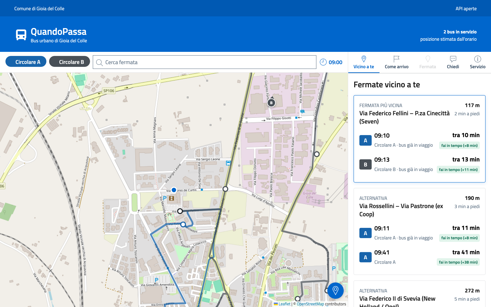
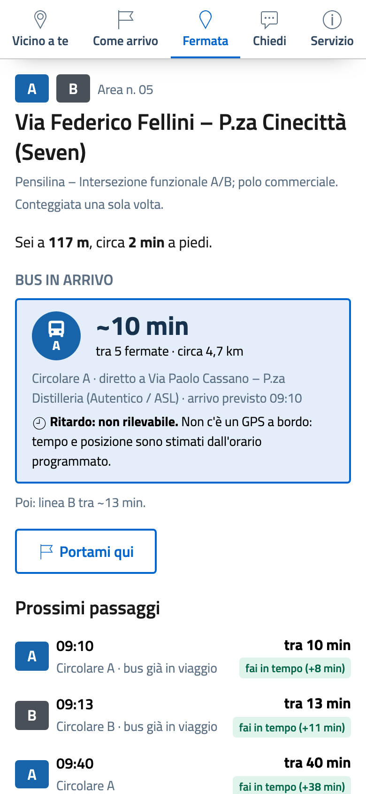
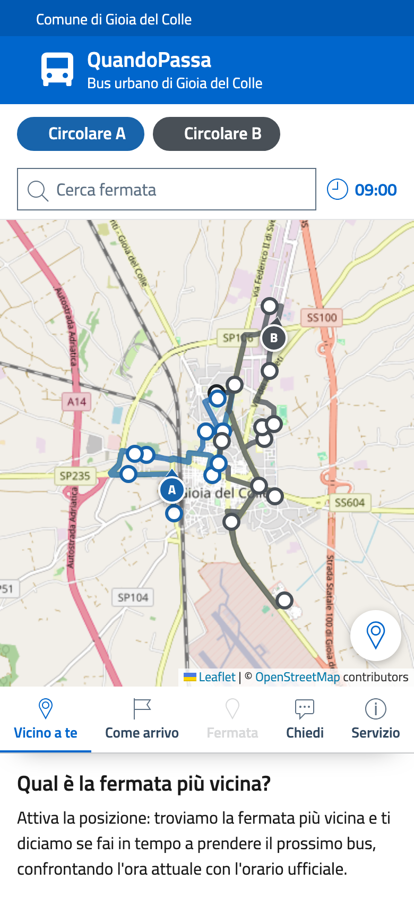
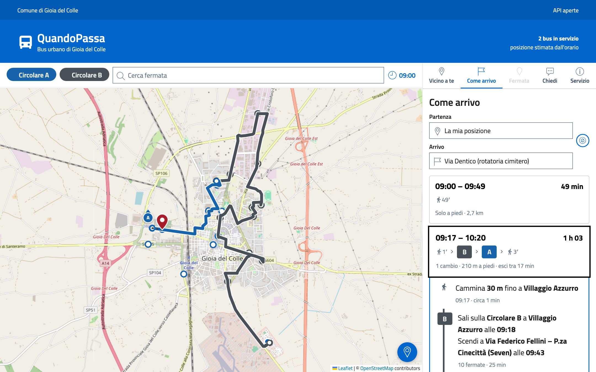
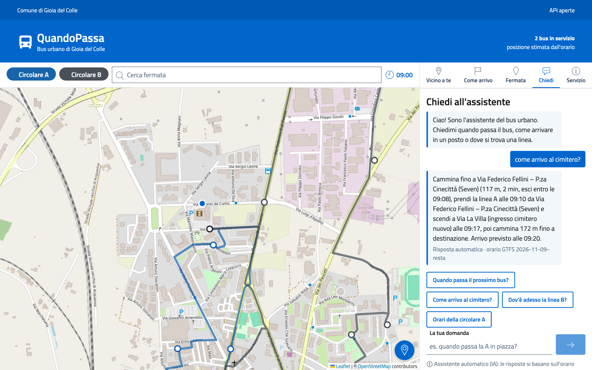

# Usare QuandoPassa

QuandoPassa è una pagina web: si apre dal browser del telefono o del computer, senza installare app e senza
registrarsi.

<video class="video-verticale" controls muted playsinline preload="metadata" poster="../demo/verticale-poster.jpg">
  <source src="../demo/quandopassa-demo-verticale.mp4" type="video/mp4">
</video>

## 1. Guarda i bus sulla mappa

Ogni bus in servizio è un cerchio con la lettera della linea e una freccia che indica la direzione. Si muove
lungo il percorso stradale secondo l'orario ufficiale. In alto puoi mostrare o nascondere la **Circolare A** e
la **Circolare B**, e vedi l'ora attuale.

Fuori dall'orario di servizio (le linee girano la mattina, dal lunedì al sabato) la mappa ti dice quando parte
la prossima corsa.

## 2. Trova la fermata più vicina

Tocca **Usa la mia posizione**. QuandoPassa ti mostra le fermate più vicine con la distanza e i minuti a piedi e,
per ogni bus in arrivo, ti dice se:

- **fai in tempo** (e con quanti minuti di margine);
- devi **affrettarti**;
- **non fai in tempo**, e allora conviene aspettare il successivo.

La posizione **resta sul tuo telefono**: serve solo a questo calcolo e non viene salvata. Se preferisci non
condividerla, tocca una fermata sulla mappa o cercala per nome.

## 3. Alla fermata: il bus in arrivo

Aprendo una fermata vedi in evidenza il **bus più vicino**:

- **tra quanti minuti arriva**, circa;
- **quante fermate** e **quanti metri** mancano lungo il percorso;
- **dov'è adesso** (per esempio "diretto a Piazza Plebiscito") e l'orario di arrivo previsto.

Toccando il riquadro il bus viene evidenziato sulla mappa. Sotto trovi i prossimi passaggi della giornata.

!!! note "E il ritardo?"
    Sui bus non c'è un GPS: tempi e posizioni sono stimati dall'orario. Per questo il ritardo **non è
    rilevabile** e l'app lo scrive chiaramente. Controlla sempre alla fermata.

{ .telefono }

{ .telefono }

## 4. Come arrivo

Nella scheda **Come arrivo** scegli la partenza (la tua posizione, una fermata, un indirizzo, un luogo o un punto
toccando la mappa) e l'arrivo. QuandoPassa ti propone le soluzioni in ordine di arrivo, come un navigatore:

- quanto **camminare** fino alla fermata e da quale fermata salire;
- **quale bus** prendere e a che ora, dove scendere;
- se serve, **dove cambiare** e quanto attendere (per esempio dalla B alla A a Seven);
- **solo a piedi**, quando si arriva prima che aspettando il bus.

Toccando una soluzione vedi i passi uno per uno e il viaggio sulla mappa: a piedi tratteggiato, in bus con il
colore della linea. Dalla scheda di una fermata, **Portami qui** la imposta come destinazione.

<video class="video-verticale" controls muted playsinline preload="metadata" poster="../demo/come-arrivo-verticale-poster.jpg">
  <source src="../demo/quandopassa-come-arrivo-verticale.mp4" type="video/mp4">
</video>

## 5. Chiedi all'assistente

Nella scheda **Chiedi** puoi scrivere come parleresti a una persona:

- *"Quando passa il prossimo bus da Piazza Plebiscito?"*
- *"Come arrivo al cimitero?"* (con la posizione attiva ti dice dove salire e a che ora uscire di casa)
- *"Dov'è adesso la linea B?"*
- *"Quanto costa il biglietto?"*

L'assistente è un sistema di **intelligenza artificiale** e la pagina lo dichiara. Capisce la domanda, ma orari
e minuti li calcola sempre l'app dall'orario ufficiale: l'IA non può inventarli.

## Accessibilità

L'interfaccia segue il design system della Pubblica Amministrazione (Bootstrap Italia): si usa da tastiera, con
gli screen reader e con il testo ingrandito. Gli esiti come "fai in tempo" hanno sempre colore **e** testo.
