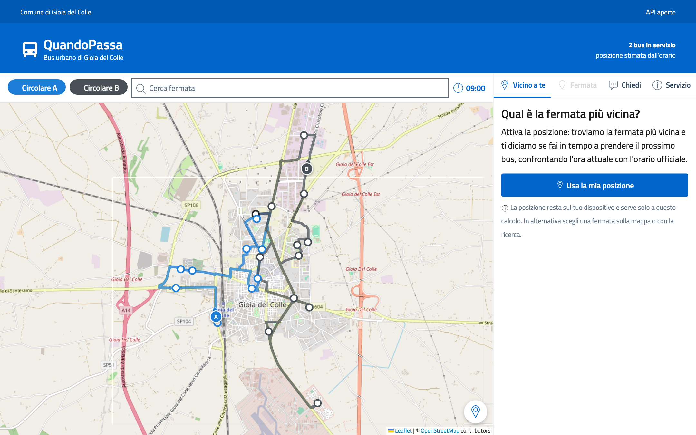
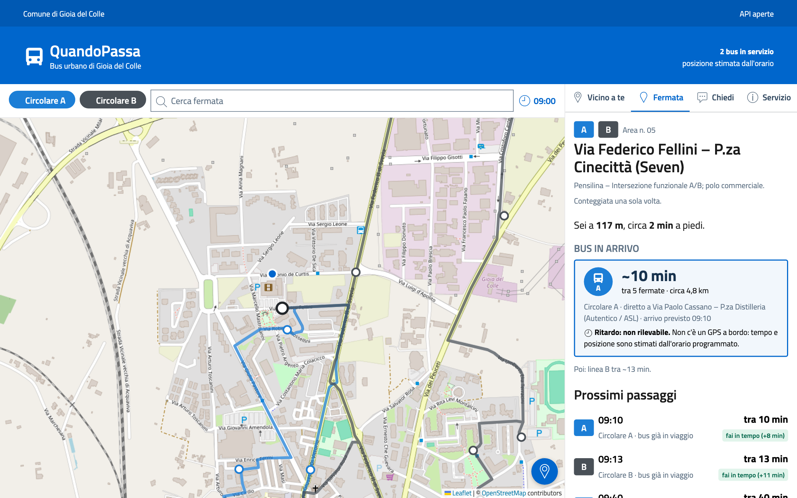

# QuandoPassa

**Il bus urbano sulla mappa, senza mettere un GPS sui bus.**
QuandoPassa legge l'orario ufficiale in formato GTFS e mostra dove si trova ogni bus *secondo l'orario*,
qual è la fermata più vicina, tra quanti minuti arriva il prossimo bus e se fai in tempo a prenderlo.
Pilota proposto: servizio urbano di Gioia del Colle, Circolari A e B.

<video class="video-demo" controls muted playsinline preload="metadata" poster="screenshot/01_mappa.png">
  <source src="demo/quandopassa-demo.mp4" type="video/mp4">
  Il tuo browser non riproduce video: <a href="demo/quandopassa-demo.mp4">scarica il video</a>.
</video>

*Quaranta secondi di demo: bus sulla mappa, fermata più vicina, bus in arrivo, ricerca e assistente IA.
L'istanza demo usa un orologio fisso su un mercoledì mattina, quando circolano entrambe le linee.*

## Scegli da dove partire

-   :material-bus-clock: **Cittadini**

    ---

    Il bus sulla mappa del telefono, la fermata più vicina con i minuti a piedi, il bus in arrivo e
    un assistente a cui chiedere in italiano. Niente app da installare, niente registrazione.

    [:octicons-arrow-right-24: Usare QuandoPassa](cittadini.md)

-   :material-bank: **Comune**

    ---

    Un servizio informativo moderno senza comprare apparati AVM/GPS: basta l'orario in GTFS.
    Nessun dato personale salvato, interfaccia Bootstrap Italia, codice EUPL-1.2 riusabile.

    [:octicons-arrow-right-24: Benefici per il Comune](comune.md) ·
    [Feed GTFS e fermate](gtfs.md)

-   :material-server: **Sviluppatori e ufficio IT**

    ---

    Tre container (app, inferenza, MCP), nessun database, configurazione in un file `.env`,
    API JSON aperte e un server MCP per collegare assistenti e agenti.

    [:octicons-arrow-right-24: Installazione](installazione.md) ·
    [Architettura e API](architettura.md) · [Server MCP](mcp.md)

## Cosa vedi

## Onestà sui dati

!!! info "Posizioni stimate, non rilevate"
    Sui bus non c'è un GPS. La posizione e i minuti di attesa sono **calcolati dall'orario programmato**,
    lungo il percorso stradale della linea, e l'app lo dichiara sempre. Per lo stesso motivo il **ritardo non
    è rilevabile**: QuandoPassa lo scrive invece di mostrare un "in orario" che non può verificare.
    Con un feed GTFS-Realtime dell'azienda di trasporto i ritardi veri si potrebbero aggiungere.

## Oggi e domani

| | Oggi | Con QuandoPassa |
|---|---|---|
| Dov'è il bus | non si sa | **sulla mappa**, stimato dall'orario |
| Fermata più vicina | bisogna conoscerla | trovata dalla **posizione del telefono** |
| Quando passa | orario da consultare | **"tra ~10 min"**, con fermate e metri che mancano |
| Faccio in tempo? | a occhio | **"fai in tempo"**, **"affrettati"**, **"non fai in tempo"** |
| Domande | telefono all'azienda | **assistente IA** in italiano, orari calcolati dall'app |
| Altri sistemi | nessuna integrazione | **API aperte** e **server MCP** |

!!! warning "Proposta indipendente"
    QuandoPassa è una **proposta** al Comune di Gioia del Colle, non un servizio ufficiale del Comune o
    dell'azienda di trasporto. Le fermate sono le 20 aree della proposta preliminare di localizzazione delle
    pensiline e le loro posizioni sono **indicative**, da confermare con il sopralluogo.
