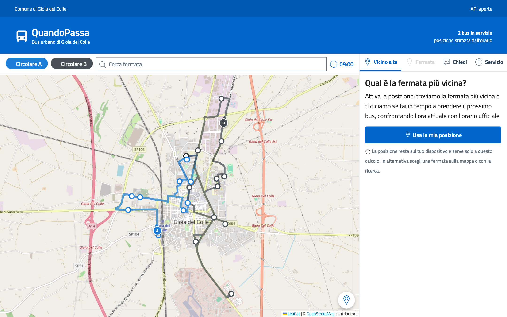
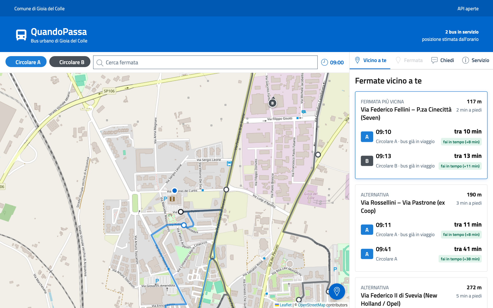
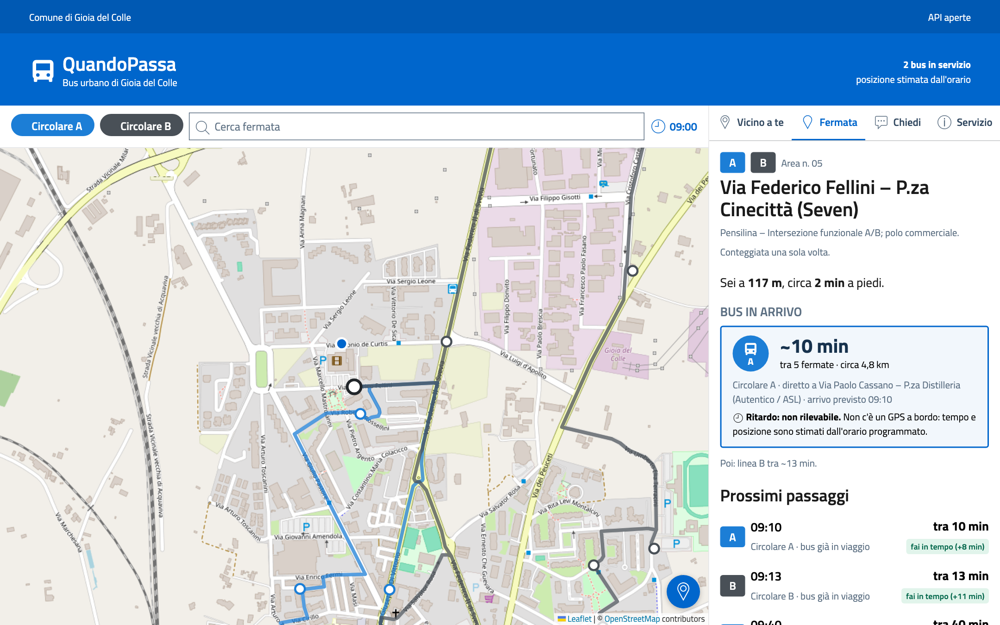
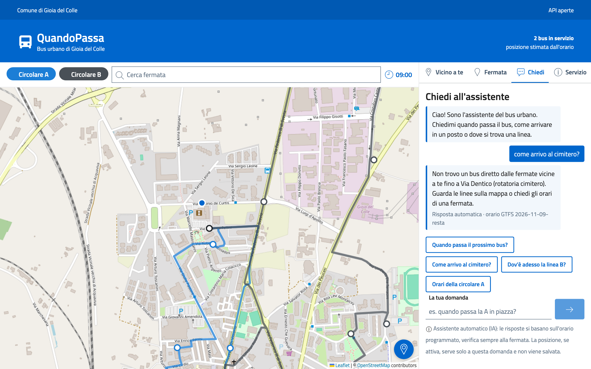
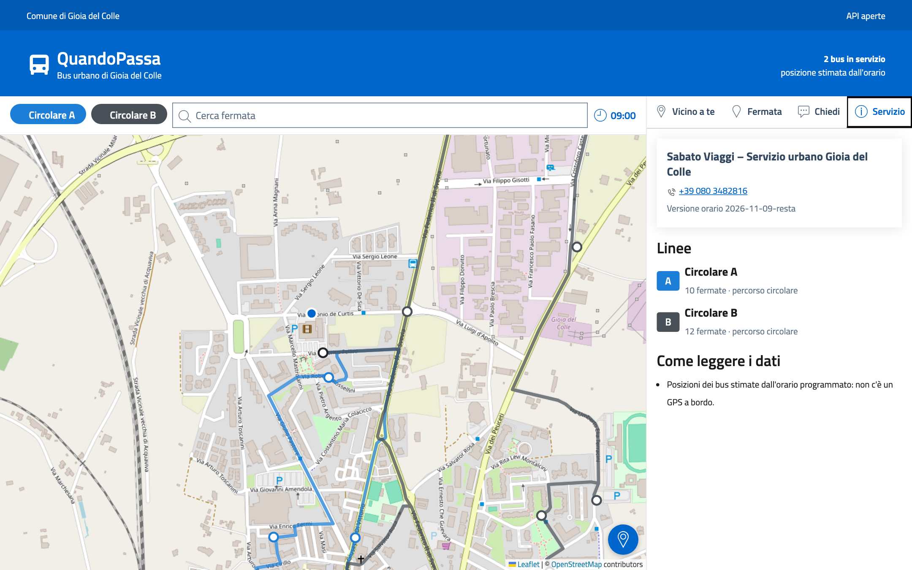
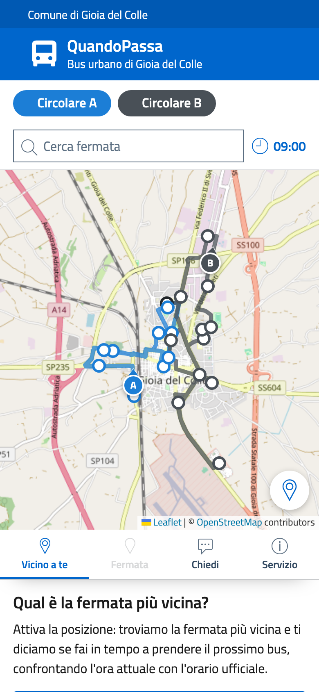

# Video e demo

I video sono registrati sull'**istanza demo**, con l'orologio fisso su mercoledì 11/11/2026 alle 09:00, quando
circolano entrambe le linee. Le posizioni dei bus sono stimate dall'orario programmato, come nell'app reale.

## Orizzontale 16:9 (presentazioni, LinkedIn, YouTube)

<video class="video-demo" controls muted playsinline preload="metadata" poster="../screenshot/01_mappa.png">
  <source src="../demo/quandopassa-demo.mp4" type="video/mp4">
</video>

[:material-download: MP4](demo/quandopassa-demo.mp4){ .md-button }
[:material-download: GIF](demo/quandopassa-demo.gif){ .md-button }

## Verticale 9:16 (reel, storie, WhatsApp)

<video class="video-verticale" controls muted playsinline preload="metadata" poster="../demo/verticale-poster.jpg">
  <source src="../demo/quandopassa-demo-verticale.mp4" type="video/mp4">
</video>

[:material-download: MP4 verticale](demo/quandopassa-demo-verticale.mp4){ .md-button }

## Screenshot

<div class="grid screens" markdown>













</div>

## Rigenerare video e screenshot

I video vengono registrati da Playwright, che percorre da solo l'istanza demo con una posizione simulata vicino
alla fermata Seven, e montati con `ffmpeg`.

```bash
pip install playwright && playwright install chromium     # serve anche ffmpeg
make demo                                                 # istanza demo su :8001
make video                                                # 16:9, 9:16 e screenshot in docs/
```

`make video` riavvia la demo prima di ogni registrazione, perché il copione trovi i bus dove se li aspetta.
Le didascalie sono in `scripts/registra_demo.py`.
